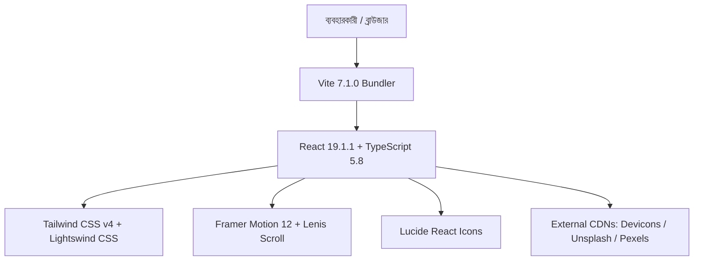
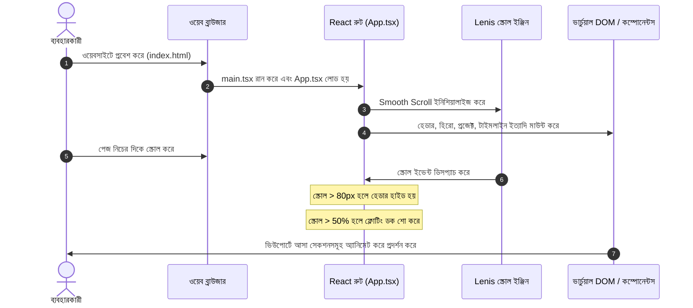

# প্রজেক্ট অ্যানালাইসিস রিপোর্ট (Project Analysis Report)
**প্রজেক্টের নাম:** Animated Professional Portfolio (`portfolio01`)  
**প্রতিবেদন তৈরির তারিখ:** ১৯ অক্টোবর, ২০২৬  
**বিশ্লেষণকারী:** Antigravity AI Code Analysis Engine  
**বর্তমান ডেভেলপমেন্ট স্ট্যাটাস:** Frontend Prototype / Visual Architecture Complete (Functional Backend & Form Processing Incomplete)

---

## সূচিপত্র (Table of Contents)
1. [Project Overview (প্রজেক্ট পরিচিতি)](#১-project-overview-প্রজেক্ট-পরিচিতি)
2. [Technology Stack (প্রযুক্তিগত কাঠামো)](#২-technology-stack-প্রযুক্তিগত-কাঠামো)
3. [Project Structure (প্রজেক্ট ফোল্ডার ও ফাইল আর্কিটেকচার)](#৩-project-structure-প্রজেক্ট-ফোল্ডার-ও-ফাইল-আর্কিটেকচার)
4. [Features & Functionalities (ফিচার এবং কার্যপ্রণালী)](#৪-features--functionalities-ফিচার-এবং-কার্যপ্রণালী)
5. [Database Analysis (ডাটাবেজ বিশ্লেষণ)](#৫-database-analysis-ডাটাবেজ-বিশ্লেষণ)
6. [API Analysis (এপিআই বিশ্লেষণ)](#৬-api-analysis-এপিআই-বিশ্লেষণ)
7. [Authentication & Security (অথেনটিকেশন ও নিরাপত্তা ব্যবস্থা)](#৭-authentication--security-অথেনটিকেশন-ও-নিরাপত্তা-ব্যবস্থা)
8. [UI/UX Analysis (ইউজার ইন্টারফেস ও ইউজার এক্সপেরিয়েন্স বিশ্লেষণ)](#৮-uiux-analysis-ইউজার-ইন্টারফেস-ও-ইউজার-এক্সপেরিয়েন্স-বিশ্লেষণ)
9. [Project Workflow (সিস্টেমের সামগ্রিক কার্যপদ্ধতি)](#৯-project-workflow-সিস্টেমের-সামগ্রিক-কার্যপদ্ধতি)
10. [Issues & Missing Features (সমস্যা, বাগ এবং অনুপস্থিত ফিচার)](#১০-issues--missing-features-সমস্যা-বাগ-এবং-অনুপস্থিত-ফিচার)
11. [Recommendations (সুপারিশ ও ভবিষ্যৎ কর্মপরিকল্পনা)](#১১-recommendations-সুপারিশ-ও-ভবিষ্যৎ-কর্মপরিকল্পনা)
12. [Final Project Summary (চূড়ান্ত পর্যালোচনা ও মূল্যায়ন)](#১২-final-project-summary-চূড়ান্ত-পর্যালোচনা-ও-মূল্যায়ন)

---

## ১. Project Overview (প্রজেক্ট পরিচিতি)

### ১.১ প্রজেক্টের নাম (Project Name)
প্রজেক্টটির অফিশিয়াল প্যাকেজ নাম `portfolio01` (উৎস: [`package.json`](file:///c:/Users/livem/Downloads/Animated_Professional_Portfolio/portfolio01/package.json#L2))। এটি "Scarlett Rose" নামে একজন কাল্পনিক/বাস্তব "Director of Product Engineering" এবং "Senior Full-Stack AI & UX Architect"-এর প্রিমিয়াম অ্যানিমেটেড পোর্টফোলিও ওয়েবসাইট হিসেবে তৈরি করা হয়েছে।

### ১.২ মূল উদ্দেশ্য (Main Purpose)
এই প্রজেক্টের মূল উদ্দেশ্য হলো একজন সিনিয়র টেক লিডার এবং ফুল-স্ট্যাক সফটওয়্যার ইঞ্জিনিয়ারের ক্যারিয়ার প্রোফাইল, টেকনিক্যাল দক্ষতা, সফল প্রজেক্টসমূহ, একাডেমিক ব্যাকগ্রাউন্ড এবং ক্লায়েন্ট রিভিউ অত্যন্ত দৃষ্টিনন্দন ও আধুনিক অ্যানিমেশনের মাধ্যমে বিশ্বমানের ক্লায়েন্ট বা রিক্রুটারদের কাছে তুলে ধরা।

### ১.৩ এটি কী সমস্যা সমাধান করে (What Problem It Solves)
- **চিরাচরিত স্ট্যাটিক পোর্টফোলিওর সীমাবদ্ধতা দূরীকরণ:** গতানুগতিক স্ট্যাটিক পোর্টফোলিওগুলো ব্যবহারকারীর আকর্ষণ ধরে রাখতে পারে না। এই প্রজেক্টটি মসৃণ স্ক্রোলিং (Smooth Scrolling), ইন্টারেক্টিভ থ্রিডি ও ফিজিক্স কার্ড, ডাইনামিক মাউস কার্সর এবং কাস্টম ডক নেভিগেশনের মাধ্যমে উচ্চমাত্রার ইন্টারেক্টিভিটি প্রদান করে।
- **ব্যক্তিগত ব্র্যান্ডিং ও অথরিটি প্রতিষ্ঠা:** একজন হাই-লেভেল ইঞ্জিনিয়ারের ভিজ্যুয়াল রুচি, মাইক্রো-ইন্টারঅ্যাকশনের প্রতি মনোযোগ এবং আধুনিক ফ্রন্টএন্ড আর্কিটেকচার সম্পর্কে গভীর দখল সরাসরি ওয়েবসাইটের মাধ্যমেই প্রমাণিত হয়।

### ১.৪ প্রজেক্টের ধরন (Project Type)
এটি একটি **Client-Side Single Page Application (SPA)** / **Frontend Web Application**। সম্পূর্ণ প্রজেক্টটি ব্রাউজারে চালিত হয় এবং এতে কোনো সক্রিয় সার্ভার-সাইড কোড বা ব্যাকএন্ড এপিআই সরাসরি যুক্ত নেই।

| প্যারামিটার | বিবরণ | প্রমাণ ফাইল |
| :--- | :--- | :--- |
| **Project Name** | `portfolio01` | [`package.json`](file:///c:/Users/livem/Downloads/Animated_Professional_Portfolio/portfolio01/package.json) |
| **Application Type** | Client-Side SPA (Single Page Application) | [`src/App.tsx`](file:///c:/Users/livem/Downloads/Animated_Professional_Portfolio/portfolio01/src/App.tsx) |
| **Target Audience** | Global Tech Recruiters, Enterprise Clients, Engineering Leaders | [`src/components/HeroSection/HeroSection.tsx`](file:///c:/Users/livem/Downloads/Animated_Professional_Portfolio/portfolio01/src/components/HeroSection/HeroSection.tsx) |
| **Deployment Mode** | Static Hosting (Vercel / Netlify / GitHub Pages / Cloudflare Pages) | [`vite.config.ts`](file:///c:/Users/livem/Downloads/Animated_Professional_Portfolio/portfolio01/vite.config.ts) |

---

## ২. Technology Stack (প্রযুক্তিগত কাঠামো)

প্রজেক্টটিতে ব্যবহৃত প্রযুক্তিসমূহের পুঙ্খানুপুঙ্খ তালিকা নিচে প্রদান করা হলো:



### ২.১ Frontend Technologies (ফ্রন্টএন্ড প্রযুক্তি)
- **Core Language:** TypeScript 5.8.3 ([`package.json`](file:///c:/Users/livem/Downloads/Animated_Professional_Portfolio/portfolio01/package.json#L46)), JSX/TSX
- **Core UI Library:** React v19.1.1 & React-DOM v19.1.1 ([`package.json`](file:///c:/Users/livem/Downloads/Animated_Professional_Portfolio/portfolio01/package.json#L26-L27))
- **Build Tool & Bundler:** Vite v7.1.0 ([`package.json`](file:///c:/Users/livem/Downloads/Animated_Professional_Portfolio/portfolio01/package.json#L48))
- **Compiler Plugin:** `@vitejs/plugin-react-swc` v3.11.0 (সুপার-ফাস্ট রাস্ট-বেসড SWC কম্পাইলার)
- **CSS Framework:** Tailwind CSS v4.1.11 (`@tailwindcss/vite` ইন্টিগ্রেশনের মাধ্যমে কনফিগার করা)
- **CSS Theme & Utilities:** Modern CSS Variables, `clsx` (v2.1.1), `tailwind-merge` (v3.6.0), `class-variance-authority` (v0.7.1)
- **Typography:** `@fontsource/geist-sans` (v5.2.5), `geist` (v1.4.2)

### ২.২ Animation & Interaction Libraries
- **Framer Motion (v12.23.12):** পেজ সেকশনের রিভিল অ্যানিমেশন, মোবাইল ড্রয়ার ট্রানজিশন, হোভার এফেক্ট এবং ফ্লোটিং ডক এন্ট্রির জন্য ব্যবহৃত।
- **Lenis (v1.3.8) & Lenis/React:** স্মুথ মোমেন্টাম পেজ স্ক্রোলিং পরিচালনার জন্য রুট কম্পোনেন্টে ব্যবহৃত ([`src/App.tsx`](file:///c:/Users/livem/Downloads/Animated_Professional_Portfolio/portfolio01/src/App.tsx#L13))।
- **GSAP (v3.15.0) & @gsap/react (v2.1.2):** জটিল টাইমলাইন ও ফিজিক্স অ্যানিমেশনের লাইব্রেরি হিসেবে ডিপেন্ডেন্সিতে অন্তর্ভুক্ত।
- **Three.js (v0.185.1) & @types/three:** থ্রিডি গ্রাফিক্স ও ক্যানভাস রেন্ডারিং সাপোর্ট।
- **Lightswind UI (v3.1.25):** কাস্টম প্রিমিয়াম কম্পোনেন্ট কিট (`HangingIdCard`, `AuroraTextEffect`, `Dock`, `MagicCard`, `ScrollTimeline`, `MorphingText`, ইত্যাদি)।

### ২.৩ Backend Technologies (ব্যাকএন্ড প্রযুক্তি)
- **Status:** **কোনো সক্রিয় ব্যাকএন্ড নেই (None)**। প্রজেক্টটিতে কোনো Node.js/Express, Python/Django, কিংবা Go/PHP ভিত্তিক সার্ভার কোড নেই।

### ২.৪ Database (ডাটাবেজ)
- **Status:** **কোনো ডাটাবেজ নেই (None)**। কোনো SQL (PostgreSQL, MySQL) বা NoSQL (MongoDB, Firebase) ডাটাবেজের সংযোগ নেই। সমস্ত ডাটা সরাসরি রিঅ্যাক্ট কম্পোনেন্টে স্ট্যাটিক অবজেক্ট আকারে সংজ্ঞায়িত।

### ২.৫ Frameworks & Libraries Summary Table
| প্যাকেজ নাম | সংস্করণ | কাজের ক্ষেত্র | স্ট্যাটাস |
| :--- | :--- | :--- | :--- |
| `react` / `react-dom` | `^19.1.1` | কোর ইউআই রেন্ডারিং ইঞ্জিন | সক্রিয়ভাবে ব্যবহৃত |
| `vite` | `^7.1.0` | ডেভ সার্ভার ও প্রোডাকশন বান্ডলার | কনফিগার করা |
| `@tailwindcss/vite` | `^4.1.11` | নেক্সট-জেন সিএসএস স্টাইলিং ইঞ্জিন | সক্রিয়ভাবে ব্যবহৃত |
| `framer-motion` | `^12.23.12` | ডিক্লারেটিভ কম্পোনেন্ট অ্যানিমেশন | সক্রিয়ভাবে ব্যবহৃত |
| `lenis` | `^1.3.8` | মোমেন্টাম স্মুথ স্ক্রলিং | সক্রিয়ভাবে ব্যবহৃত |
| `lucide-react` | `^0.539.0` | ভেক্টর ইউআই আইকন সেট | সক্রিয়ভাবে ব্যবহৃত |
| `next-themes` | `^0.4.6` | ডার্ক/লাইট মোড স্টেট ম্যানেজমেন্ট | ডিপেন্ডেন্সিতে বিদ্যমান |
| `three` | `^0.185.1` | WebGL 3D রেন্ডারিং ইঞ্জিন | ডিপেন্ডেন্সিতে বিদ্যমান |
| `gsap` | `^3.15.0` | অ্যাডভান্সড অ্যানিমেশন ইঞ্জিন | ডিপেন্ডেন্সিতে বিদ্যমান |

### ২.৬ Third-party APIs and Integrations (তৃতীয় পক্ষের এপিআই ও ইন্টিগ্রেশন)
প্রজেক্টটিতে সরাসরি কোনো থার্ড পার্টি রেস্ট এপিআই (REST API) কল করা হয় না। তবে নিচের পাবলিক সিডিএন (CDN) রিসোর্সগুলো এক্সটার্নাল মিডিয়া হিসেবে ব্যবহৃত হচ্ছে:
1. **Devicons CDN (`cdn.jsdelivr.net`):** টেকনোলজি লোগোসমূহ ফেচ করতে ব্যবহৃত ([`src/components/TechStackSection/TechStackSection.tsx`](file:///c:/Users/livem/Downloads/Animated_Professional_Portfolio/portfolio01/src/components/TechStackSection/TechStackSection.tsx#L4-L18))।
2. **Unsplash (`images.unsplash.com`):** আইডি কার্ডের অ্যাভাটার ছবির জন্য ([`src/components/HeroSection/HeroSection.tsx`](file:///c:/Users/livem/Downloads/Animated_Professional_Portfolio/portfolio01/src/components/HeroSection/HeroSection.tsx#L132))।
3. **Pexels (`images.pexels.com`):** প্রজেক্ট প্রিভিউ ও টেস্টমোনিয়াল ক্লায়েন্ট ছবির জন্য ([`src/components/ProjectsSection/ProjectsSection.tsx`](file:///c:/Users/livem/Downloads/Animated_Professional_Portfolio/portfolio01/src/components/ProjectsSection/ProjectsSection.tsx#L11-L35), [`src/components/TestimonialsSection/TestimonialsSection.tsx`](file:///c:/Users/livem/Downloads/Animated_Professional_Portfolio/portfolio01/src/components/TestimonialsSection/TestimonialsSection.tsx#L9-L21))।

---

## ৩. Project Structure (প্রজেক্ট ফোল্ডার ও ফাইল আর্কিটেকচার)

### ৩.১ ফোল্ডার ডিরেক্টরি ট্রি (Folder Tree)
```text
portfolio01/
├── dist/                              # পূর্বনির্মিত প্রোডাকশন বান্ডল ফাইল
│   ├── assets/                        # অপ্টিমাইজড JS, CSS ও ফন্ট ফাইল
│   ├── index.html                     # ডিস্ট্রিবিউশন রুট ফাইল
│   └── vite.svg
├── public/                            # স্ট্যাটিক পাবলিক অ্যাসেট
│   └── vite.svg
├── src/                               # মূল সোর্স কোড ডিরেক্টরি
│   ├── assets/                        # ইন্টারনাল অ্যাসেট (react.svg)
│   ├── components/                    # ইউআই সেকশন ও কম্পোনেন্টস
│   │   ├── AboutSection/              # About Me এবং পরিসংখ্যান সেকশন
│   │   ├── CareerSection/             # ক্যারিয়ার টাইমলাইন সেকশন
│   │   ├── ContactSection/            # যোগাযোগ ফর্ম ও তথ্য সেকশন
│   │   ├── EducationSection/          # শিক্ষাগত যোগ্যতা ও স্কিল সেকশন
│   │   ├── Footer/                    # গ্লোবাল ফুটার ও টেক্সট মর্ফিং
│   │   ├── Header/                    # গ্লোবাল হেডার ও মোবাইল মেনু
│   │   ├── HeroSection/               # ল্যান্ডিং ব্যানার ও ইন্টারেক্টিভ আইডি কার্ড
│   │   ├── ProjectsSection/           # ১২-কলাম বেন্তো গ্রিড প্রজেক্ট ডিসপ্লে
│   │   ├── ServicesSection/           # সেবাসমূহ ও ম্যাজিক কার্ড
│   │   ├── TechStackSection/          # ইনফিনিট স্ক্রোলিং টেকনোলজি মারকুই
│   │   ├── TestimonialsSection/       # ক্লায়েন্ট রিভিউ সেকশন
│   │   ├── lib/                       # কম্পোনেন্ট ইউটিলিটি ফাইল (রিডানড্যান্ট)
│   │   ├── lightswind/                # লাইটসউইন্ড অ্যানিমেটেড কম্পোনেন্ট লাইব্রেরি (১৫৫টি ফাইল)
│   │   └── lightswind.css             # কম্পোনেন্ট স্পেসিফিক সিএসএস
│   ├── hooks/                         # কাস্টম রিঅ্যাক্ট হুকস (use-mobile, use-toast)
│   ├── lib/                           # সেন্ট্রাল হেল্পার ফাংশন (utils.ts)
│   ├── App.css                        # রুট স্টাইল ও ফন্ট ফেসিং
│   ├── App.tsx                        # মূল প্যারেন্ট লেআউট কম্পোনেন্ট
│   ├── index.css                      # গ্লোবাল টেইলউইন্ড v4 থিমিং ও কালার ভেরিয়েবল
│   ├── lightswind.css                 # লাইটসউইন্ড স্বতন্ত্র স্টাইলশিট
│   ├── main.tsx                       # রিঅ্যাক্ট অ্যাপ্লিকেশনের এন্ট্রি পয়েন্ট
│   ├── tailwind.config.ts             # টেইলউইন্ড লেগ্যাসি কনফিগারেশন
│   └── vite-env.d.ts                  # ভাইট টাইপ ডেফিনিশন
├── .gitignore                         # গিট ইগনোর রুলস
├── eslint.config.js                   # ইএসলিন্ট কনফিগারেশন ফাইল
├── index.html                         # এইচটিএমএল শেল
├── package.json                       # ডিপেন্ডেন্সি ও স্ক্রিপ্ট ডিক্লারেশন
├── package-lock.json                  # লক ফাইল
├── README.md                          # ডিফল্ট ভাইট টেমপ্লেট ডকু
├── tsconfig.app.json                  # ক্লায়েন্ট কোডের টাইপস্ক্রিপ্ট কনফিগ
├── tsconfig.json                      # রুট টাইপস্ক্রিপ্ট প্রজেক্ট রেফারেন্স
├── tsconfig.node.json                 # নোড এনভায়রনমেন্টের টাইপস্ক্রিপ্ট কনফিগ
└── vite.config.ts                     # ভাইট সার্ভার ও প্লাগইন কনফিগারেশন
```

### ৩.২ গুরুত্বপূর্ণ ফাইল এবং তাদের ভূমিকা (Important Files & Purposes)

| ফাইলের পথ (File Path) | ফাইলের ভূমিকা ও দায়িত্ব (Role & Purpose) |
| :--- | :--- |
| [`index.html`](file:///c:/Users/livem/Downloads/Animated_Professional_Portfolio/portfolio01/index.html) | ব্রাউজারের এন্ট্রি পেজ; এতে `#root` এলিমেন্ট এবং ডিফল্ট `data-theme="dark"` নির্ধারিত রয়েছে। |
| [`vite.config.ts`](file:///c:/Users/livem/Downloads/Animated_Professional_Portfolio/portfolio01/vite.config.ts) | পোর্ট ৮০৮০ নির্ধারণ, `@` পাথ এলিয়াস সেটআপ, SWC রিঅ্যাক্ট প্লাগইন এবং Tailwind Vite প্লাগইন কনফিগার করে। |
| [`src/main.tsx`](file:///c:/Users/livem/Downloads/Animated_Professional_Portfolio/portfolio01/src/main.tsx) | `createRoot` ব্যবহার করে React DOM রেন্ডার করে এবং Geist Sans ফন্ট ইমপোর্ট করে। |
| [`src/App.tsx`](file:///c:/Users/livem/Downloads/Animated_Professional_Portfolio/portfolio01/src/App.tsx) | প্রধান সমন্বয়ক কম্পোনেন্ট; এতে Lenis স্ক্রোল প্রোভাইডার, স্মুথ কার্সর, হেডার, ৮টি কনটেন্ট সেকশন, ফুটার এবং ফ্লোটিং ডক রয়েছে। |
| [`src/index.css`](file:///c:/Users/livem/Downloads/Animated_Professional_Portfolio/portfolio01/src/index.css) | আধুনিক Tailwind CSS v4 থিম সেটআপ, গ্লাস-প্যানেল (`.glass-panel`), গ্রেডিয়েন্ট এবং ডার্ক/লাইট মোডের সিএসএস ভেরিয়েবল ধারণ করে। |
| [`src/lib/utils.ts`](file:///c:/Users/livem/Downloads/Animated_Professional_Portfolio/portfolio01/src/lib/utils.ts) | `clsx` ও `twMerge` দিয়ে তৈরি `cn()` ফাংশন, `debounce()`, `throttle()`, `formatDate()` ইত্যাদি প্রয়োজনীয় ইউটিলিটি ফাংশন ধারণ করে। |
| [`src/components/Header/Header.tsx`](file:///c:/Users/livem/Downloads/Animated_Professional_Portfolio/portfolio01/src/components/Header/Header.tsx) | স্মার্ট হেডার নেভিগেশন, ইউজার স্ক্রোল-ডাউন করলে লুকায় এবং স্ক্রোল-আপ করলে ভেসে ওঠে; মোবাইল রেসপন্সিভ মেনু ধারণ করে। |
| [`src/components/HeroSection/HeroSection.tsx`](file:///c:/Users/livem/Downloads/Animated_Professional_Portfolio/portfolio01/src/components/HeroSection/HeroSection.tsx) | ল্যান্ডিং ব্যানার যাতে একটি ইন্টারেক্টিভ ঝুলন্ত আইডি কার্ড (`HangingIdCard`), অরোরা টেক্সট এফেক্ট এবং টেক মারকুই রয়েছে। |
| [`src/components/ProjectsSection/ProjectsSection.tsx`](file:///c:/Users/livem/Downloads/Animated_Professional_Portfolio/portfolio01/src/components/ProjectsSection/ProjectsSection.tsx) | ১২-কলামের অসম বেন্টো গ্রিড (Bento Grid) যার মাধ্যমে নির্বাচিত প্রজেক্টসমূহ প্রদর্শিত হয়। |
| [`src/components/CareerSection/CareerTimeline.tsx`](file:///c:/Users/livem/Downloads/Animated_Professional_Portfolio/portfolio01/src/components/CareerSection/CareerTimeline.tsx) | ভার্টিক্যাল স্ক্রোল প্রগ্রেস লাইনসহ ক্যারিয়ারের বিগত ১৬ বছরের অভিজ্ঞতার টাইমলাইন প্রদর্শন করে। |
| [`src/components/EducationSection/EducationSection.tsx`](file:///c:/Users/livem/Downloads/Animated_Professional_Portfolio/portfolio01/src/components/EducationSection/EducationSection.tsx) | ডিগ্রি, গবেষণাপত্র ও সম্মাননাসহ একাডেমিক তথ্যাবলি এবং অ্যানিমেটেড স্কিল বার প্রদর্শন করে। |
| [`src/components/ContactSection/ContactSection.tsx`](file:///c:/Users/livem/Downloads/Animated_Professional_Portfolio/portfolio01/src/components/ContactSection/ContactSection.tsx) | কন্টাক্ট ইনফরমেশন এবং একটি ফ্রন্টএন্ড ফর্ম ইন্টারফেস। |

### ৩.৩ মডিউলসমূহের পারস্পরিক সংযোগ (Module Connectivity)
1. **লেআউট সংযোগ:** [`src/App.tsx`](file:///c:/Users/livem/Downloads/Animated_Professional_Portfolio/portfolio01/src/App.tsx)-এ ক্রমান্বয়ে সবকটি সেকশনকে সিঙ্গল পেজ ফ্লোতে সাজানো হয়েছে।
2. **আইডি ভিত্তিক স্ক্রোল লিংকিং:** হেডারের নেভিগেশন আইটেম এবং ডক নেভিগেশনের বাটনগুলো সংশ্লিষ্ট সেকশনের ইউনিক আইডির (`#hero`, `#about`, `#services`, `#projects`, `#career`, `#education`, `#testimonials`, `#contact`) সাথে লিঙ্ক করা।
3. **কমন স্টাইল ও ইউটিলিটি:** সমস্ত সেকশন কম্পোনেন্ট একই গ্লোবাল স্টাইল ক্লাসরুল (`glass-panel`, `text-gradient-primary`) এবং লাইব্রেরি কম্পোনেন্ট (`MagicCard`, `Badge`, `Button`) শেয়ার করে।

---

## ৪. Features & Functionalities (ফিচার এবং কার্যপ্রণালী)

### ৪.১ বিদ্যমান ফিচারের তালিকা ও কাজের পদ্ধতি
1. **Lenis Momentum Smooth Scrolling:** সাধারণ ব্রাউজার স্ক্রোলিংয়ের বদলে ফ্লুইড ইনার্শিয়াল স্ক্রোলিং সক্রিয় থাকে, যা ব্রাউজিংকে অত্যন্ত আরামদায়ক করে।
2. **Custom Smooth Cursor (`SmoothCursor`):** মাউস পয়েন্টারের সাথে একটি অ্যানিমেটেড ট্রেইল ও গ্লো এফেক্ট অনুসরণ করে ([`src/App.tsx`](file:///c:/Users/livem/Downloads/Animated_Professional_Portfolio/portfolio01/src/App.tsx#L18))।
3. **Adaptive Auto-hiding Navigation Header:** ব্যবহারকারী যখন নিচের দিকে স্ক্রোল করে (> ৮০ পিক্সেল), হেডারটি উপরে মসৃণভাবে অদৃশ্য হয়ে যায়; আবার সামান্য উপরের দিকে স্ক্রোল করলে তাৎক্ষণিক পুনরায় প্রদর্শিত হয় ([`src/components/Header/Header.tsx`](file:///c:/Users/livem/Downloads/Animated_Professional_Portfolio/portfolio01/src/components/Header/Header.tsx#L23-L35))।
4. **Interactive Theme Switching (Dark & Light Mode):** হেডারে থাকা `ThemeToggle` বাটনে ক্লিক করলে View Transition API ও CSS ভেরিয়েবলের মাধ্যমে ডার্ক ও লাইট থিমের মধ্যে সুইচ করা যায় ([`src/components/lightswind/theme-toggle.tsx`](file:///c:/Users/livem/Downloads/Animated_Professional_Portfolio/portfolio01/src/components/lightswind/theme-toggle.tsx))।
5. **Interactive 3D Hanging ID Card:** হিরো সেকশনে ফিজিক্স সিমুলেশন যুক্ত একটি আইডি কার্ড রশি দিয়ে ঝুলানো রয়েছে, যা মাউস মুভমেন্ট এবং হোভারে দোলে ও প্রতিক্রিয়া দেখায় ([`src/components/lightswind/HangingIdCard.tsx`](file:///c:/Users/livem/Downloads/Animated_Professional_Portfolio/portfolio01/src/components/lightswind/HangingIdCard.tsx))।
6. **Dynamic Aurora Typography:** ডার্ক মোডে নামের টেক্সটে সাইকেল অ্যানিমেটেড রঙিন আলো বিচ্ছুরিত হয় (`AuroraTextEffect`), এবং লাইট মোডে ভাইব্রেন্ট গ্রেডিয়েন্ট টেক্সট রেন্ডার হয়।
7. **Infinite Tech Stack Marquee:** ১৫টি জনপ্রিয় প্রযুক্তির আইকন ডান থেকে বামে নিরবচ্ছিন্নভাবে স্ক্রোল হতে থাকে। হোভার করলে স্ক্রোল সাময়িকভাবে পজ (Pause) হয় ([`src/components/TechStackSection/TechStackSection.tsx`](file:///c:/Users/livem/Downloads/Animated_Professional_Portfolio/portfolio01/src/components/TechStackSection/TechStackSection.tsx#L36))।
8. **12-Column Asymmetrical Bento Grid:** বিভিন্ন আকৃতির (৭ কলাম ও ৫ কলাম বিশিষ্ট) কার্ডে প্রজেক্টগুলো সাজানো। হোভারে ছবির স্কেলিং ও অ্যাকশন অ্যারো আইকনের রোটেশন ঘটে ([`src/components/ProjectsSection/ProjectsSection.tsx`](file:///c:/Users/livem/Downloads/Animated_Professional_Portfolio/portfolio01/src/components/ProjectsSection/ProjectsSection.tsx#L58-L101))।
9. **Vertical Milestone Scroll Timeline:** বিগত ১৬ বছরের ক্যারিয়ার ইতিহাস ক্রমান্বয়ে স্ক্রোল পজিশনের ওপর ভিত্তি করে উজ্জ্বল প্রগ্রেস লাইনসহ রিভিল হয় ([`src/components/CareerSection/CareerTimeline.tsx`](file:///c:/Users/livem/Downloads/Animated_Professional_Portfolio/portfolio01/src/components/CareerSection/CareerTimeline.tsx#L50-L64))।
10. **Interactive Magic Cards (Mouse Follower Glow):** সার্ভিসেস এবং এডুকেশন কার্ডগুলোতে মাউস পয়েন্টার হোভার করলে কার্ডের বর্ডারে ডাইনামিক লাইট স্পটলাইট অনুসরণ করে ([`src/components/lightswind/magic-card.tsx`](file:///c:/Users/livem/Downloads/Animated_Professional_Portfolio/portfolio01/src/components/lightswind/magic-card.tsx))।
11. **Animated Skill Progress Bars:** টেকনিক্যাল স্কিল সেকশন স্ক্রিনে আসলে প্রগ্রেস বারগুলো ০% থেকে নির্দিষ্ট শতকরা হারে স্প্রিং ট্রানজিশনের সাথে ফিল হয় ([`src/components/EducationSection/SkillCategory.tsx`](file:///c:/Users/livem/Downloads/Animated_Professional_Portfolio/portfolio01/src/components/EducationSection/SkillCategory.tsx#L82-L91))।
12. **Scroll-Triggered macOS-Style Floating Dock:** ব্যবহারকারী পেজের ৫০% গভীরে স্ক্রোল করলে স্ক্রিনের নিচে একটি ভাসমান ডক ভেসে ওঠে, যার আইকনগুলোতে ক্লিক করে দ্রুত বিভিন্ন সেকশনে জাম্প করা যায় ([`src/App.tsx`](file:///c:/Users/livem/Downloads/Animated_Professional_Portfolio/portfolio01/src/App.tsx#L81-L99))।
13. **Dynamic Morphing Text Banner:** ফুটারে এসভিজি ফিল্টারের মাধ্যমে টেক্সটগুলো একে অপরে রূপান্তর (Morph) হতে থাকে ([`src/components/Footer/Footer.tsx`](file:///c:/Users/livem/Downloads/Animated_Professional_Portfolio/portfolio01/src/components/Footer/Footer.tsx#L78-L84))।

### ৪.২ সম্পন্ন বনাম অসম্পূর্ণ ফিচার শনাক্তকরণ (Completed vs Incomplete Features)

| ফিচারের নাম | বাস্তবায়নের বর্তমান অবস্থা | ফাইল রেফারেন্স | মন্তব্য |
| :--- | :--- | :--- | :--- |
| **Responsive Navigation** | **Completed** | [`src/components/Header/Header.tsx`](file:///c:/Users/livem/Downloads/Animated_Professional_Portfolio/portfolio01/src/components/Header/Header.tsx) | ডেস্কটপ ও মোবাইলে সম্পূর্ণ কার্যকর |
| **Dark/Light Mode Theme** | **Completed** | [`src/components/lightswind/theme-toggle.tsx`](file:///c:/Users/livem/Downloads/Animated_Professional_Portfolio/portfolio01/src/components/lightswind/theme-toggle.tsx) | থিম সুইচ সম্পূর্ণ কার্যকর |
| **Interactive ID Badge** | **Completed** | [`src/components/lightswind/HangingIdCard.tsx`](file:///c:/Users/livem/Downloads/Animated_Professional_Portfolio/portfolio01/src/components/lightswind/HangingIdCard.tsx) | ফিজিক্স মোশন সম্পূর্ণ কার্যকর |
| **Bento Grid Layout** | **Completed** | [`src/components/ProjectsSection/ProjectsSection.tsx`](file:///c:/Users/livem/Downloads/Animated_Professional_Portfolio/portfolio01/src/components/ProjectsSection/ProjectsSection.tsx) | লেআউট ও হোভার অ্যানিমেশন সম্পূর্ণ |
| **Career Scroll Timeline** | **Completed** | [`src/components/CareerSection/CareerTimeline.tsx`](file:///c:/Users/livem/Downloads/Animated_Professional_Portfolio/portfolio01/src/components/CareerSection/CareerTimeline.tsx) | স্ক্রোল ট্র্যাকিং কার্যকর |
| **Contact Form Submission** | **Incomplete / Mock** | [`src/components/ContactSection/ContactSection.tsx#L59`](file:///c:/Users/livem/Downloads/Animated_Professional_Portfolio/portfolio01/src/components/ContactSection/ContactSection.tsx#L59) | শুধুমাত্র `e.preventDefault()`; কোনো ডাটা পাঠানো হয় না |
| **Resume Download Button** | **Incomplete** | [`src/components/HeroSection/HeroSection.tsx#L87`](file:///c:/Users/livem/Downloads/Animated_Professional_Portfolio/portfolio01/src/components/HeroSection/HeroSection.tsx#L87) | বাটনে কোনো ডাউনলোড লিঙ্ক বা হ্যান্ডলার নেই |
| **View Work Button** | **Incomplete** | [`src/components/HeroSection/HeroSection.tsx#L84`](file:///c:/Users/livem/Downloads/Animated_Professional_Portfolio/portfolio01/src/components/HeroSection/HeroSection.tsx#L84) | ক্লিক করলে প্রজেক্ট সেকশনে নিয়ে যাওয়ার হ্যান্ডলার নেই |
| **Project External Links** | **Incomplete / Placeholder** | [`src/components/ProjectsSection/ProjectsSection.tsx#L10`](file:///c:/Users/livem/Downloads/Animated_Professional_Portfolio/portfolio01/src/components/ProjectsSection/ProjectsSection.tsx#L10) | সমস্ত লিঙ্ক `href="#"` দেওয়া |
| **Social Media Links** | **Incomplete / Placeholder** | [`src/components/Footer/Footer.tsx#L28-L30`](file:///c:/Users/livem/Downloads/Animated_Professional_Portfolio/portfolio01/src/components/Footer/Footer.tsx#L28-L30) | সমস্ত সোশ্যাল লিঙ্ক `href="#"` দেওয়া |

### ৪.৩ ইউজার রোল ও পারমিশন (User Roles and Permissions)
- **Status:** **প্রযোজ্য নয় (Not Applicable / Not Implemented)**। যেহেতু প্রজেক্টটিতে কোনো অথেনটিকেশন বা ব্যবহারকারী প্রোফাইল সিস্টেম নেই, তাই কোনো ইউজার রোল (যেমন: Admin, Editor, Guest) বা পারমিশন স্তর বিদ্যমান নেই। সকল ভিজিটর পাবলিক রিড-ওনলি অ্যাক্সেস উপভোগ করেন।

---

## ৫. Database Analysis (ডাটাবেজ বিশ্লেষণ)

### ৫.১ ডাটাবেজ আর্কিটেকচার (Database Architecture)
- **Current State:** **কোনো ডাটাবেজ নেই (No Database)**।
- **যাচাইয়ের ফলাফল:** প্রজেক্ট ফাইলের কোথাও কোনো ORM (যেমন: Prisma, Drizzle, Mongoose, TypeORM) অথবা ডাটাবেজ কানেকশন স্ট্রিং বিদ্যমান নেই।

### ৫.২ টেবিল / কালেকশন এবং রিলেশনশিপ (Tables, Collections & Relationships)
- কোনো ডাটাবেজ টেবিল বা কালেকশন নেই।

### ৫.৩ ডাটা কীভাবে সংরক্ষিত ও সংগৃহীত হয় (How Data is Stored & Retrieved)
সমস্ত তথ্য রিঅ্যাক্ট সোর্স ফাইলের ভেতর সরাসরি হার্ডকোডেড মেমরি অ্যারে (In-Memory Arrays) আকারে সংরক্ষিত থাকে:
- প্রজেক্ট তথ্য: [`src/components/ProjectsSection/ProjectsSection.tsx`](file:///c:/Users/livem/Downloads/Animated_Professional_Portfolio/portfolio01/src/components/ProjectsSection/ProjectsSection.tsx#L5-L38)-এর `projects` অ্যারে।
- ক্যারিয়ার তথ্য: [`src/components/CareerSection/CareerTimeline.tsx`](file:///c:/Users/livem/Downloads/Animated_Professional_Portfolio/portfolio01/src/components/CareerSection/CareerTimeline.tsx#L5-L46)-এর `careerEvents` অ্যারে।
- শিক্ষাগত তথ্য: [`src/components/EducationSection/EducationSection.tsx`](file:///c:/Users/livem/Downloads/Animated_Professional_Portfolio/portfolio01/src/components/EducationSection/EducationSection.tsx#L7-L38)-এর `education` অ্যারে।
- স্কিল তথ্য: [`src/components/EducationSection/SkillCategory.tsx`](file:///c:/Users/livem/Downloads/Animated_Professional_Portfolio/portfolio01/src/components/EducationSection/SkillCategory.tsx#L18-L33)-এর `technicalSkills` ও `softSkills` অ্যারে।
- রিভিউ ও প্রশংসাপত্র: [`src/components/TestimonialsSection/TestimonialsSection.tsx`](file:///c:/Users/livem/Downloads/Animated_Professional_Portfolio/portfolio01/src/components/TestimonialsSection/TestimonialsSection.tsx#L4-L23)-এর `testimonials` অ্যারে।

---

## ৬. API Analysis (এপিআই বিশ্লেষণ)

### ৬.১ বিদ্যমান এপিআই এন্ডপয়েন্ট (Existing API Endpoints)
- **Status:** **কোনো এপিআই এন্ডপয়েন্ট নেই (No API Endpoints)**।
- প্রজেক্টটিতে কোনো অভ্যন্তরীণ REST বা GraphQL রাউট নেই (যেমন: `/api/contact` বা `/api/projects` জাতীয় কোনো এন্ডপয়েন্ট নেই)।

### ৬.২ এইচটিটিপি মেথড (HTTP Methods)
- কোনো সক্রিয় সার্ভার-সাইড হ্যান্ডলার নেই (GET, POST, PUT, DELETE অপ্রযোজ্য)।

### ৬.৩ অথেনটিকেশন ও অথরাইজেশন (Authentication & Authorization)
- কোনো এপিআই সিকিউরিটি মেকানিজম বা টোকেন ভ্যালিডেশন নেই।

### ৬.৪ রিকোয়েস্ট ও রেসপন্স স্ট্রাকচার (Request & Response Structures)
- বর্তমানে ব্রাউজার থেকে কোনো ব্যাকএন্ডে রিকোয়েস্ট পাঠানো হয় না। কন্টাক্ট ফর্মের সাবমিট হ্যান্ডলারে কেবল ডিফল্ট রিফ্রেশ থামানোর কোড রয়েছে:
```tsx
// src/components/ContactSection/ContactSection.tsx (লাইন ৫৯)
<form className="space-y-5" onSubmit={(e) => e.preventDefault()}>
```

---

## ৭. Authentication & Security (অথেনটিকেশন ও নিরাপত্তা ব্যবস্থা)

### ৭.১ লগইন ও রেজিস্ট্রেশন সিস্টেম (Login & Registration)
- **Status:** **অনুপস্থিত (Not Implemented)**। প্রজেক্টটিতে কোনো লগইন বা রেজিস্ট্রেশন কার্যপদ্ধতি নেই।

### ৭.২ ব্যবহারকারী প্রমাণীকরণ ও আরব্যাক (User Authentication & RBAC)
- **Status:** **প্রযোজ্য নয় (Not Applicable)**।

### ৭.৩ সম্ভাব্য নিরাপত্তা দুর্বলতা ও ঝুঁকি (Security Vulnerabilities & Risks)
যদিও অ্যাপ্লিকেশনটি একটি ক্লায়েন্ট-সাইড স্ট্যাটিক পোর্টফোলিও, কোড পর্যালোচনা করে কিছু গুরুত্বপূর্ণ পর্যবেক্ষণ পাওয়া গেছে:

1. **Contact Form Abuse Risk (কন্টাক্ট ফর্ম অপব্যবহারের ঝুঁকি):**  
   বর্তমানে ফর্মে কোনো ইনপুট ভ্যালিডেশন (যেমন: Zod / Yup), কোনো রেট লিমিটিং (Rate Limiting) বা বট প্রোটেকশন (Cloudflare Turnstile বা Google reCAPTCHA) নেই। ভবিষ্যতে যখন ব্যাকএন্ড বা ইমেইল এপিআই যুক্ত করা হবে, তখন এটি স্প্যাম বট বা মেইল বোম্বিংয়ের ঝুঁকিতে পড়বে।
2. **Third-party Asset Dependability & Privacy Leakage:**  
   প্রজেক্টটি সরাসরি বাহ্যিক ডোমেইন (`images.unsplash.com`, `images.pexels.com`, `cdn.jsdelivr.net`) থেকে ছবি লোড করে। যদি কোনো থার্ড-পার্টি ডোমেইন ডাউন থাকে বা ছবি মুছে ফেলা হয়, তবে সাইটের ইমেজ ভেঙে যাবে (Broken Link)। এছাড়া বাহ্যিক সিডিএন ইউজারের ব্রাউজার রিকোয়েস্টের রেফারার হেডার পর্যবেক্ষণ করতে পারে।
3. **Absence of Content Security Policy (CSP):**  
   [`index.html`](file:///c:/Users/livem/Downloads/Animated_Professional_Portfolio/portfolio01/index.html)-এ কোনো সিকিউরিটি হেডার বা CSP মেটা ট্যাগ ডিক্লেয়ার করা নেই। ফলে এক্সটার্নাল স্ক্রিপ্ট ইনজেকশন বা ডোমেইন হাইজ্যাকিংয়ের বিরুদ্ধে কোনো অতিরিক্ত সুরক্ষা নেই।
4. **Use of `dangerouslySetInnerHTML`:**  
   [`src/components/TechStackSection/TechStackSection.tsx#L55`](file:///c:/Users/livem/Downloads/Animated_Professional_Portfolio/portfolio01/src/components/TechStackSection/TechStackSection.tsx#L55)-এ মারকুই কী-ফ্রেম ইঞ্জেক্ট করতে `dangerouslySetInnerHTML` ব্যবহার করা হয়েছে। যদিও এই কোডে ইনজেকশন স্ট্রিংটি স্ট্যাটিক, তবুও এটি সাধারণ রিঅ্যাক্ট সিকিউরিটি বেস্ট প্র্যাকটিসের পরিপন্থী।

---

## ৮. UI/UX Analysis (ইউজার ইন্টারফেস ও ইউজার এক্সপেরিয়েন্স বিশ্লেষণ)

### ৮.১ বিদ্যমান পেজ ও কম্পোনেন্টস (Pages & Components Breakdown)

```text
[Header - Sticky Glassmorphic Navigation with Theme Toggle]
  ↓
[HeroSection - Headline, Hanging ID Card, Status Badge & CTA]
  ↓
[TechStackSection - Infinite Seamless Running Logo Marquee]
  ↓
[AboutSection - Biography & 2x2 Metric Cards Grid]
  ↓
[ServicesSection - 4x MagicCard Service Capabilities with Hover Glow]
  ↓
[ProjectsSection - 12-Column Responsive Bento Grid Showcase]
  ↓
[CareerSection - Interactive Vertical Scroll Timeline]
  ↓
[EducationSection - Academic Credentials & Animated Skills Bar]
  ↓
[TestimonialsSection - 3x Client Review Glass Cards with Quotation Glow]
  ↓
[ContactSection - Communication Channels & Stylized Message Form]
  ↓
[Footer - Morphing SVG Text Display, Back-to-Top, Social Links]
  ↓
[Floating Dock - Scroll-triggered Dynamic Section Quick-Launcher]
```

### ৮.২ নেভিগেশন স্ট্রাকচার (Navigation Architecture)
- **Top Glassmorphic Navbar:** হোমপেজের শীর্ষে স্থির থাকে, স্ক্রোল করলে অটোমেটিক হাইড/আনহাইড হয়।
- **Mobile Hamburger Drawer:** ছোট পর্দায় ফুলস্ক্রিন ব্যাকড্রপ ব্লায়ারের সাথে স্প্রিং অ্যানিমেশনে নেভিগেশন আইটেম প্রদর্শন করে।
- **Floating macOS Dock:** পেজের অর্ধেক স্ক্রোল করার পর নিচে স্বয়ংক্রিয়ভাবে আবির্ভূত হয় এবং বড় পর্দায় দ্রুত যেকোনো সেকশনে স্মুথ স্ক্রোল করে যাওয়ার সুযোগ দেয়।
- **Back-to-Top Action:** ফুটারের কুইক বাটন ব্যবহারকারীকে পেজের শীর্ষে ফিরিয়ে নেয়।

### ৮.৩ রেসপন্সিভ ডিজাইন (Responsive Design Verification)
- **Mobile First Adaptation:** Tailwind CSS-এর ব্রেকপয়েন্ট (`sm:`, `md:`, `lg:`) ব্যবহার করে মোবাইল ও ডেস্কটপ ভিউ চমৎকারভাবে সাজানো।
- **মোবাইল অপ্টিমাইজেশন:** ছোট স্ক্রিনে ফ্লোটিং ডকটি স্বয়ংক্রিয়ভাবে হাইড হয়ে যায় (`hidden md:block`), যাতে ব্যবহারকারীর কনটেন্ট দেখতে সমস্যা না হয়।
- **বেন্তো গ্রিড অ্যাডাপ্টেশন:** ১২-কলামের বেন্তো গ্রিড মোবাইল স্ক্রিনে সুন্দরভাবে সিঙ্গেল কলামে পরিবর্তিত হয়।

### ৮.৪ UI/UX-এর শক্তিমত্তা ও দুর্বলতা (Strengths & Weaknesses)

#### শক্তিমত্তা (Strengths):
- **উচ্চমানের ভিজ্যুয়াল নান্দনিকতা:** নিও-ব্রুটালিজম ও মডার্ন গ্লাস-মরফিজমের মিশ্রণ, সুক্ষ্ম বর্ডার লাইটিং, ডার্ক মোডে অরোরা টেক্সট গ্লো সাইটের প্রিমিয়াম ফিল নিশ্চিত করে।
- **স্মুথ মাইক্রো-ইন্টারঅ্যাকশন:** মাউস ট্র্যাকিং কাস্টম কার্সর, আইডি কার্ড সুইং ও ম্যাজিক কার্ডের গ্রেডিয়েন্ট বর্ডার অত্যন্ত চিত্তাকর্ষক।
- **Lenis স্ক্রোলিং:** সাধারণ ব্রাউজার স্ক্রোলিংয়ের চেয়ে অনেক বেশি মসৃণ ও প্রিমিয়াম এক্সপেরিয়েন্স দেয়।

#### দুর্বলতা (Weaknesses):
- **কাস্টম কার্সর লেটেন্সি (SmoothCursor):** কম কনফিগারেশনের ল্যাপটপ বা টাচস্ক্রিন ডিভাইসে কাস্টম কার্সরের কারণে কিছুটা ল্যাগ বা অতিরিক্ত সিপিইউ ইউসেজ দেখা যেতে পারে।
- **ভারী প্রাথমিক লোড:** একই পেজে ব্যাকগ্রাউন্ড ডট প্যাটার্ন, একাধিক ফ্রেমার মোশন লিসেনার, লেনিস স্ক্রোল এবং কাস্টম কার্সর একসঙ্গে চলার কারণে ব্রাউজার থ্রেডে কাজের চাপ বেশি থাকে।
- **অকার্যকর ইন্টারেক্টিভ উপাদান:** ইউজার যখন "Resume" বা "View Work"-এ ক্লিক করে কোনো ফলাফল পায় না, তখন এটি ইউজার এক্সপেরিয়েন্সকে ব্যাহত করে।

---

## ৯. Project Workflow (সিস্টেমের সামগ্রিক কার্যপদ্ধতি)

### ৯.১ সিস্টেমের কার্যপ্রবাহ (End-to-End System Flow)



### ৯.২ ফ্রন্টএন্ড-ব্যাকএন্ড যোগাযোগ (Frontend-Backend Communication)
- **বর্তমান অবস্থা:** প্রজেক্টটিতে কোনো প্রকার ব্যাকএন্ড সার্ভার বা এপিআই না থাকায় ফ্রন্টএন্ড-ব্যাকএন্ড কোনো ডেটা আদান-প্রদান নেই। সম্পূর্ণ অ্যাপ্লিকেশনটি ব্রাউজারের ভেতর স্বয়ংসম্পূর্ণভাবে ক্লায়েন্ট সাইডে নির্বাহ হয়।

### ৯.৩ প্রধান ব্যবহারকারী ওয়ার্কফ্লো (Major User Journeys)
1. **ল্যান্ডিং এবং প্রাথমিক পরিচিতি:** ব্যবহারকারী সাইটে প্রবেশ করে হিরো সেকশনে ইন্টারেক্টিভ আইডি কার্ড দেখে এবং পরিচিতি পড়ে।
2. **টেক স্ট্যাক এবং দক্ষতা নিরীক্ষণ:** চলমান টেকনোলজি মারকুই এবং এডুকেশন সেকশনে অ্যানিমেটেড প্রগ্রেস বার দেখে টেকনিক্যাল সামর্থ্য যাচাই করে।
3. **কাজের নমুনা ও ক্যারিয়ার যাচাই:** বেন্টো গ্রিডে নির্বাচিত কাজের বিবরণ পড়ে এবং ক্যারিয়ার টাইমলাইনে বিগত বছরের অগ্রগতি দেখে।
4. **যোগাযোগের চেষ্টা:** পরিশেষে কন্টাক্ট সেকশনে এসে ফর্ম পূরণ করে বা সরাসরি প্রদত্ত ইমেইলে যোগাযোগ করার সিদ্ধান্ত নেয়।

---

## ১০. Issues & Missing Features (সমস্যা, বাগ এবং অনুপস্থিত ফিচার)

কোডবেসের গভীর অনুসন্ধানে নিম্নলিখিত টেকনিক্যাল সমস্যা ও ত্রুটিগুলো চিহ্নিত হয়েছে:

| ক্রম | সমস্যা / ত্রুটির ধরন | ফাইলের অবস্থান | বিস্তারিত বিবরণ ও প্রভাব |
| :---: | :--- | :--- | :--- |
| **১** | **Missing Dependencies (`node_modules`)** | Root Directory | প্রজেক্টে `node_modules` ফোল্ডার অনুপস্থিত। যার কারণে সরাসরি `npm run build` বা `npm run dev` চালাতে গেলে ত্রুটি ঘটে। |
| **২** | **Broken Font Path in CSS** | [`src/App.css#L16-L32`](file:///c:/Users/livem/Downloads/Animated_Professional_Portfolio/portfolio01/src/App.css#L16-L32) | সিএসএসে `../node_modules/@vercel/fonts/geist-sans/...` পাথ থেকে ফন্ট লোড করার চেষ্টা করা হয়েছে, যা প্যাকেজে নেই। যদিও `main.tsx`-এ `@fontsource` দিয়ে ফন্ট লোড হচ্ছে, তবুও এটি একটি ডেড কোড ও ব্রোকেন লিঙ্ক। |
| **৩** | **Extensive Library Bloat (অতিরিক্ত অব্যবহৃত ফাইল)** | [`src/components/lightswind/`](file:///c:/Users/livem/Downloads/Animated_Professional_Portfolio/portfolio01/src/components/lightswind/) | ফোল্ডারে ১৫৫টি কম্পোনেন্ট ফাইল রয়েছে, যার মধ্যে মাত্র প্রায় ১২টি উপাদান প্রজেক্টে ব্যবহৃত হয়েছে। বাকি ১৪০টির বেশি ভারী ফাইল প্রোজেক্ট রিপোজিটরিকে ভারী করে রেখেছে। |
| **৪** | **Uncontrolled & Inoperative Contact Form** | [`src/components/ContactSection/ContactSection.tsx#L59`](file:///c:/Users/livem/Downloads/Animated_Professional_Portfolio/portfolio01/src/components/ContactSection/ContactSection.tsx#L59) | ফর্মে কোনো স্টেট নেই (`useState` নেই), নেই কোনো সাবমিশন লজিক। "Send Message" বাটনে চাপলে কোনো রেসপন্স পাওয়া যায় না। |
| **৫** | **Dead Click Actions (অকার্যকর বাটন)** | [`src/components/HeroSection/HeroSection.tsx#L84-L88`](file:///c:/Users/livem/Downloads/Animated_Professional_Portfolio/portfolio01/src/components/HeroSection/HeroSection.tsx#L84-L88) | "View Work" এবং "Resume" বাটনে কোনো লিঙ্ক বা হ্যান্ডলার নেই। ক্লিক করলে কোনো আউটপুট আসে না। |
| **৬** | **Placeholder Project & Social Links** | `ProjectsSection.tsx`, `Footer.tsx` | প্রজেক্টের কার্ডগুলোতে এবং সোশ্যাল আইকনগুলোতে কোনো বাস্তব ইউআরএল নেই, সবকটিতে `href="#"` বসানো। |
| **৭** | **Redundant Utility Files** | `src/components/lib/utils.js` | রুট `src/lib/utils.ts` থাকার পরও `src/components/lib/utils.js` ও `utils.d.ts` নামে হুবহু ডুপ্লিকেট ফাইল রাখা হয়েছে। একইভাবে `src/lightswind.css` এবং `src/components/lightswind.css` ডুপ্লিকেট হিসেবে সংরক্ষিত। |
| **৮** | **Missing SEO & Meta Tags** | [`index.html#L7`](file:///c:/Users/livem/Downloads/Animated_Professional_Portfolio/portfolio01/index.html#L7) | সাইটের টাইটেল এখনও ডিফল্ট `<title>Vite + React + TS</title>` রয়ে গেছে। নেই কোনো মেটা ডেসক্রিপশন, কি-ওয়ার্ড বা OpenGraph সোশ্যাল প্রিভিউ ট্যাগ। |
| **৯** | **Configuration Redundancy** | [`src/tailwind.config.ts`](file:///c:/Users/livem/Downloads/Animated_Professional_Portfolio/portfolio01/src/tailwind.config.ts) | Tailwind CSS v4 যেখানে সরাসরি `src/index.css`-এ `@theme` দিয়ে কনফিগার করা যায়, সেখানে আলাদাভাবে লেগ্যাসি টেইলউইন্ড কনফিগ ফাইল রেখে কোডে কনফিউশন তৈরি করা হয়েছে। |

---

## ১১. Recommendations (সুপারিশ ও ভবিষ্যৎ কর্মপরিকল্পনা)

প্রজেক্টটিকে একটি পূর্ণাঙ্গ, ত্রুটিমুক্ত ও প্রফেশনাল প্রোডাকশন-রেডি ওয়েবসাইটে রূপান্তর করার জন্য নিচের পদক্ষেপগুলো সুপারিশ করা হলো:

### ১১.১ ফাংশনাল ও ফিচার উন্নয়ন (Functional Improvements)
1. **কন্টাক্ট ফর্ম সক্রিয়করণ:**  
   - [EmailJS](https://www.emailjs.com/), [Resend](https://resend.com/) অথবা [Formspree](https://formspree.io/)-এর মতো একটি সার্ভারলেস মেইলিং সার্ভিস ইন্টিগ্রেট করা।
   - ফর্ম সাবমিট হলে একটি আকর্ষণীয় সাকসেস টোস্ট (`use-toast.tsx` ব্যবহার করে) প্রদর্শন করা।
2. **রিয়েল প্রজেক্ট লিংক ও লাইভ ডেমো সংযোগ:**  
   - বেন্টো গ্রিডের প্রতিটি কার্ডে সংশ্লিষ্ট প্রজেক্টের লাইভ ইউআরএল এবং গিটহাব রিপোজিটরি লিঙ্ক যুক্ত করা।
3. **সিভি / রেজুমে ডাউনলোড ইন্টিগ্রেশন:**  
   - একটি বাস্তব পিডিএফ রেজুমে `public/resume.pdf` ফোল্ডারে রেখে হিরো সেকশনের "Resume" বাটনে `<a href="/resume.pdf" download>` লিঙ্ক প্রদান করা।

### ১১.২ কোড কোয়ালিটি ও ক্লিনআপ (Codebase Optimization)
1. **অব্যবহৃত লাইব্রেরি ফাইল মুছে ফেলা:**  
   - `src/components/lightswind/` থেকে অপ্রয়োজনীয় ১৪০+ অব্যবহৃত ফাইল মুছে ফেলে প্রজেক্ট সাইজ ও বিল্ড টাইম উল্লেখযোগ্যভাবে কমিয়ে আনা।
2. **ডুপ্লিকেট ফাইল দূরীকরণ:**  
   - `src/components/lib/utils.js` ও `src/components/lib/utils.d.ts` ফাইল দুটি ডিলিট করে এককভাবে `src/lib/utils.ts` ব্যবহার করা।
3. **ব্রোকেন ফন্ট পাথ দূরীকরণ:**  
   - `src/App.css`-এর অপ্রয়োজনীয় `@font-face` ব্লক (লাইন ১৪-৩৪) মুছে ফেলা, যেহেতু `main.tsx`-এ ইতিমধ্যে `@fontsource/geist-sans` সঠিকভাবে লোড হচ্ছে।

### ১১.৩ পারফরম্যান্স ও এসইও অপ্টিমাইজেশন (Performance & SEO)
1. **এসইও মেটা ডাটা যুক্ত করা:**  
   - `index.html`-এ ডায়নামিক টাইটেল, মেটা ডেসক্রিপশন, অথর ইনফো এবং OpenGraph/Twitter Card মেটা ট্যাগ যুক্ত করা।
2. **ইমেজ সেলফ-হোস্টিং ও অপ্টিমাইজেশন:**  
   - থার্ড পার্টি সিডিএন (Unsplash/Pexels)-এর ওপর নির্ভরশীল না থেকে ছবিগুলোকে সংকুচিত করে আধুনিক `WebP` ফরম্যাটে প্রজেক্টের `public/images/` ডিরেক্টরিতে হোস্ট করা।

---

## ১২. Final Project Summary (চূড়ান্ত পর্যালোচনা ও মূল্যায়ন)

### ১২.১ বর্তমান ডেভেলপমেন্ট পর্যায় (Current Development Status)
প্রজেক্টটি বর্তমানে **Frontend Visual Prototype Stage** বা ডিজাইন আর্কিটেকচার সম্পন্ন পর্যায়ে রয়েছে। এর ইউজার ইন্টারফেস ও অ্যানিমেশন ডিজাইন প্রায় ১০০% সম্পন্ন হলেও, কার্যকরী ইন্টারঅ্যাকশন (ফর্ম প্রসেসিং, এক্সটার্নাল লিংকিং, ইত্যাদি) এখনও অসম্পূর্ণ।

### ১২.২ সামগ্রিক আর্কিটেকচার রিভিউ (Overall Architecture Review)
- **ডিজাইন প্যাটার্ন:** মডার্ন কম্পোনেন্ট-ড্রাইভেন SPA আর্কিটেকচার।
- **কোড মডুলারিটি:** চমৎকার; প্রতিটি সেকশন নিজস্ব ডেডিকেটেড ফোল্ডার ও ফাইলে সুন্দরভাবে বিভক্ত।
- **স্টাইলিং পদ্ধতি:** Tailwind CSS v4 ভেরিয়েবল এবং আধুনিক গ্লাস-মরফিজম।

### ১২.৩ মূল শক্তিমত্তা ও উন্নতির ক্ষেত্রসমূহ (Strengths vs Areas Needing Improvement)

```text
+------------------------------------------+------------------------------------------+
|            মূল শক্তিমত্তা (Strengths)        |     উন্নতির ক্ষেত্র (Needs Improvement)    |
+------------------------------------------+------------------------------------------+
| ✔ আধুনিক, দৃষ্টিনন্দন ও প্রিমিয়াম ডিজাইন   | ✖ কন্টাক্ট ফর্ম সম্পূর্ণ অকার্যকর (Mock)  |
| ✔ Lenis স্মুথ স্ক্রোলিং ও ফ্লুইড ট্রানজিশন | ✖ ১৪০+ অব্যবহৃত ফাইলের কারণে কোডবেস ভারী |
| ✔ ডার্ক/লাইট মোড থিমিং সম্পূর্ণ কার্যকর    | ✖ এসইও (SEO) এবং মেটা ট্যাগের অনুপস্থিতি |
| ✔ অত্যন্ত রেসপন্সিভ মোবাইল মেনু ও ডক     | ✖ বাহ্যিক সিডিএন ছবির ওপর নির্ভরশীলতা     |
| ✔ ক্লিন রিঅ্যাক্ট ১৯ ও টাইপস্ক্রিপ্ট ফ্রেমওয়ার্ক | ✖ বাটন ও প্রজেক্ট লিঙ্কগুলোতে ডেড কোড   |
+------------------------------------------+------------------------------------------+
```

### ১২.৪ পরবর্তী প্রস্তাবিত পদক্ষেপ (Recommended Next Development Steps)
1. টার্মিনালে `npm install` চালিয়ে মিসিং ডিপেন্ডেন্সিগুলো ইনস্টল করা।
2. `src/App.css`-এর ডেড ফন্ট রেফারেন্স ঠিক করা এবং অপ্রয়োজনীয় লাইব্রেরি ফাইলগুলো ক্লিন করা।
3. কন্টাক্ট ফর্মে ইমেইল সার্ভিস (যেমন: EmailJS বা Resend) যুক্ত করে সক্রিয় করা।
4. `index.html`-এ এসইও মেটা ট্যাগ, সোশ্যাল প্রিভিউ এবং ফেভিকন আপডেট করা।
5. সমস্ত প্রজেক্ট ও সোশ্যাল লিঙ্ক বাস্তব ঠিকানায় প্রতিস্থাপন করা।

---
*রিপোর্ট সমাপ্ত।*  
*ফাইলটি সফলভাবে প্রজেক্ট রুট ডিরেক্টরিতে `PROJECT_ANALYSIS_REPORT.md` হিসেবে সংরক্ষিত।*

